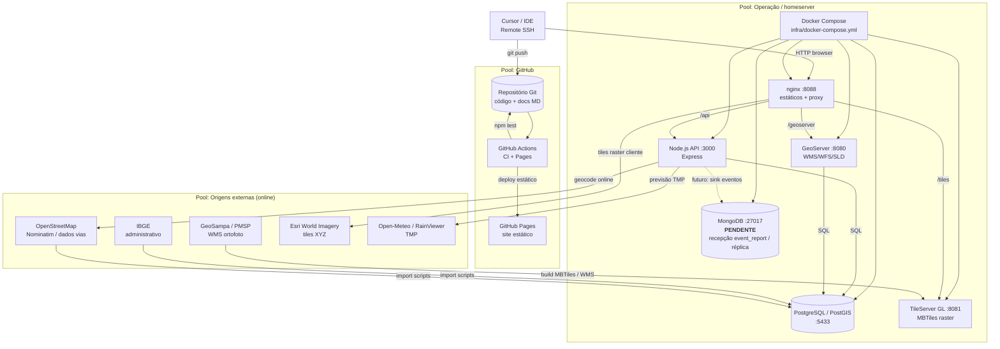

# Arquitectura TabGis — vista de colaboração (notação BPMN-like)

Este documento resume **módulos externos e internos** do TabGis numa vista próxima de **diagrama de colaboração BPMN** (pools e fluxos de mensagem). A sintaxe é [Mermaid](https://mermaid.js.org/) (renderiza em GitHub, VS Code e no HTML gerado a partir deste MD).

> **Nota:** não é ficheiro BPMN 2.0 XML; para editar em [bpmn.io](https://bpmn.io/) pode transpor manualmente os pools abaixo. O ficheiro [`TabGis.drawio`](./TabGis.drawio) continua disponível para diagramas genéricos.

---

## Diagrama — colaboração entre sistemas

**Legenda:** setas sólidas = fluxo actual típico; tracejado = **planeado** (recepção de eventos no Mongo sem perder Postgres como fonte de verdade).

---

## Tabela — módulos e papel

| Módulo | Papel no TabGis |
|--------|-----------------|
| **GitHub** | Versionamento; **Actions** (CI `npm test`, **Pages** para site estático). |
| **PostgreSQL / PostGIS** | Dados operacionais, landbase, `events`, topologia `tabgis_utilities_topo`, `config.translation`. |
| **GeoServer** | Serviço de mapas vectoriais (WMS/WFS), estilos SLD. |
| **GeoSampa** | Fonte de ortofoto / dados municipais; pipeline offline documentado. |
| **TileServer GL** | Servir MBTiles (satélite local, GeoSampa offline). |
| **nginx** | Frontend, proxy same-origin para API, GeoServer e tiles. |
| **Node.js / API** | REST, i18n, OMS, eventos, topologia, esquemático. |
| **MongoDB** | **Pendente** como destino de **recepção** de cópias de eventos / `event_report` (Postgres mantém-se canónico). |
| **Regionalização** | Tabela `config.translation` + `02_populate_translations.sql` (EN, PT, ES, IT). |

---

## Linguagens utilizadas

| Linguagem / formato | Onde |
|---------------------|------|
| **JavaScript** (Node + browser) | `backend/`, `frontend/main.js` |
| **HTML / CSS** | `frontend/index.html`, `help.html`, `styles.css` |
| **SQL** | `infra/sql/*.sql` |
| **Shell** | `infra/scripts/`, `scripts/` |
| **Python** | Scripts de tiles / reparação (`infra/scripts/*.py`) |
| **YAML** | `docker-compose`, GitHub Actions |
| **TypeScript** | `e2e/` (Playwright) |

---

## Deploy

| Camada | Documentação |
|--------|----------------|
| Docker Compose (homeserver) | [DEPLOY.md](./DEPLOY.md), [CONTEXT_STATE.md](./CONTEXT_STATE.md) |
| GitHub Pages | [.github/workflows/pages.yml](../.github/workflows/pages.yml) |

---

## Mapas offline — baseline de referência

| Pacote | Referência detalhada |
|--------|----------------------|
| Satélite SP (MBTiles) | [CONTEXT_STATE.md](./CONTEXT_STATE.md) (secção MBTiles) e [MAPS_AND_SOURCES.md](./MAPS_AND_SOURCES.md) |
| GeoSampa | [GeoSampa_offline_operacao.md](./GeoSampa_offline_operacao.md) |

Data de **snapshot** sugerida para relatórios: ver campo no topo de [MAPS_AND_SOURCES.md](./MAPS_AND_SOURCES.md).
